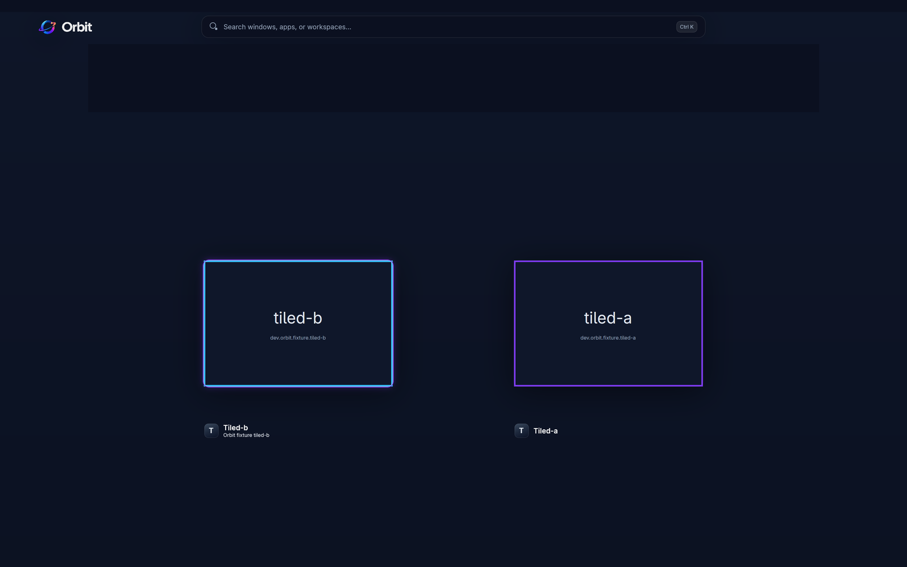
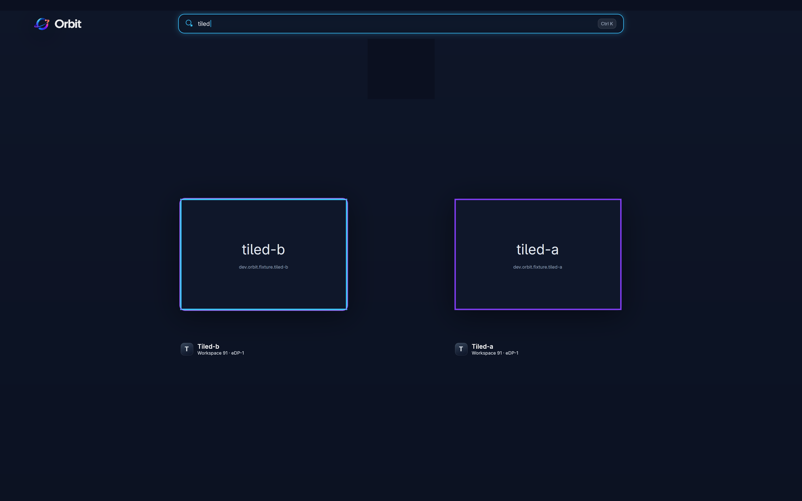
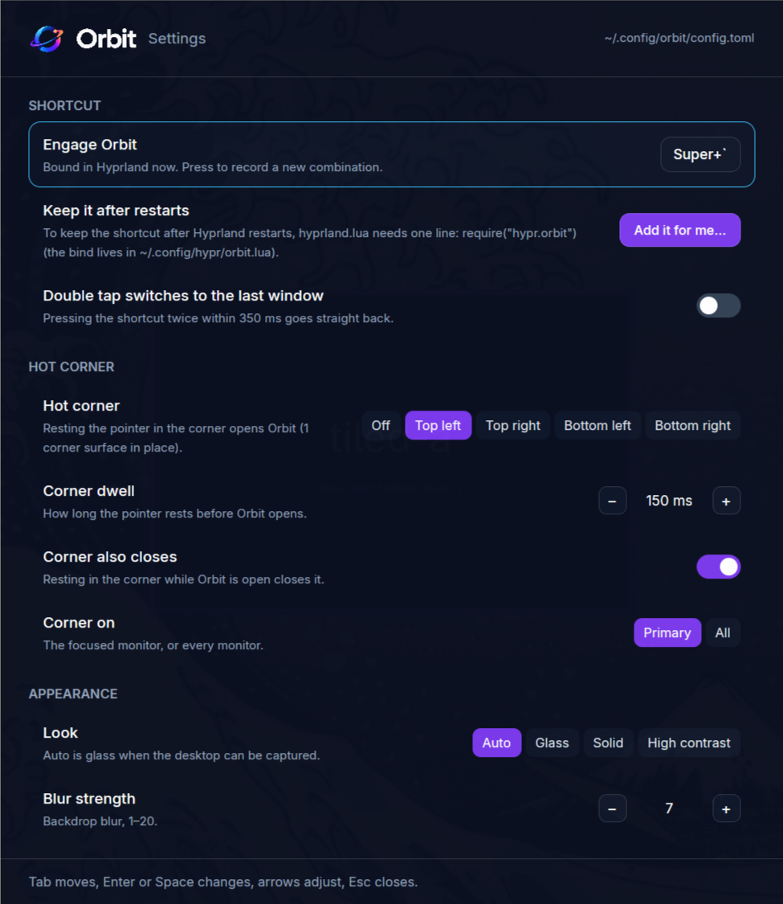

<p align="center">
  <picture>
    <source media="(prefers-color-scheme: dark)" srcset="crates/orbit-ui/assets/brand/orbit-logo-midnight.png">
    
  </picture>
</p>

<p align="center"><strong>The workspace overview for Hyprland.</strong><br>
See every window, find any of them, put them where they belong.</p>

<p align="center">
  <a href="https://github.com/last-refuge/orbit/actions/workflows/ci.yml"></a>
  <a href="https://github.com/last-refuge/orbit/releases"></a>
</p>

<p align="center">
  
</p>

Orbit is a resident companion for [Hyprland](https://hypr.land) that opens a
full-screen overview on a key, a hot corner or a command: your workspaces in a
rail along the top, every window as a live card below, and a search field that
finds windows, apps and workspaces as you type. Click a card to bring that
window forward, drag it onto a workspace to move it there, or do it all from
the keyboard. It is built for [Omarchy](https://omarchy.org) and works on any
Hyprland 0.56 session.

## Install

```bash
curl -fsSL https://raw.githubusercontent.com/last-refuge/orbit/main/install.sh | bash
```

The installer puts `orbit` in `~/.local/bin`, the desktop entry and icon under
`~/.local/share`, and prints what to do next. It never uses `sudo` and never
edits your Hyprland configuration. When no release matches your machine it
builds from source with `cargo`. Options go after `bash -s --`, for example
`--from-source`, `--prefix DIR`, `--version v0.1.0`, or `--uninstall`
(`--purge` also removes your settings).

Then start it, and press <kbd>Super</kbd>+<kbd>`</kbd>:

```bash
orbit daemon &
```

To have it start with every login:

```bash
orbit config set startup.launch_at_login true
```

### Requirements

- Hyprland 0.56 or newer (Orbit talks to its Lua-era IPC); Omarchy 4 ships it.
- A Wayland session with the layer-shell protocol (every Hyprland has one).
- A Vulkan-capable GPU and driver (Orbit renders with GPUI, the UI framework
  behind Zed).
- For live window previews: `ext-image-copy-capture` with the foreign-toplevel
  source, which Hyprland provides. `orbit doctor` reports what your session
  supports; without capture Orbit still runs, with placeholder cards.

## Using Orbit

| Do this | And Orbit |
| --- | --- |
| Press <kbd>Super</kbd>+<kbd>`</kbd> (or run `orbit toggle`) | opens the overview on the focused monitor; press again, or <kbd>Esc</kbd>, to close it |
| Rest the pointer in a screen corner | opens it too, once you pick a corner in the settings (it closes the same way) |
| Start typing | searches windows, apps and workspaces; <kbd>Enter</kbd> goes to the first match |
| Click a card | brings that window forward: its workspace, focus, and on top of the floating stack |
| Drag a card onto a workspace tile | moves the window there and keeps you where you are; hold <kbd>Shift</kbd> to follow it |
| Arrows, <kbd>Tab</kbd>, <kbd>Enter</kbd> | move between windows, the rail and the search; <kbd>Shift</kbd>+<kbd>Enter</kbd> activates and follows |
| <kbd>Ctrl</kbd>+<kbd>Shift</kbd>+<kbd>M</kbd> | opens the move menu for the selected window; type to filter the destinations |
| <kbd>Ctrl</kbd>+<kbd>/</kbd> or <kbd>F1</kbd> | shows the key hints |
| <kbd>Ctrl</kbd>+<kbd>,</kbd>, or the mark at the top left | opens the settings window |

<p align="center">
  
</p>

## Settings

Everything lives in `~/.config/orbit/config.toml`. Change it in the settings
window, with `orbit config`, or in an editor; the running daemon picks changes
up within half a second.

<p align="center">
  
</p>

```bash
orbit config list                        # every key with its current value
orbit config set hot_corner.corner top-left
orbit config set shortcut.key F12        # xkb key names; mods are SUPER, SHIFT, CTRL, ALT
```

| Key | Default | What it does |
| --- | --- | --- |
| `shortcut.mods`, `shortcut.key` | `["SUPER"]`, `grave` | the shortcut, bound live in Hyprland while the daemon runs (shown as Super+`); a combination another bind already uses is reported, not bound |
| `hot_corner.corner` | `off` | `top-left`, `top-right`, `bottom-left`, `bottom-right` |
| `hot_corner.dwell_ms` | `150` | how long the pointer rests there before the overview opens |
| `hot_corner.corner_closes` | `true` | resting there while it is open closes it |
| `hot_corner.monitors` | `primary` | the focused monitor, or `all` |
| `appearance.theme` | `auto` | `auto` is glass when the desktop can be captured; `glass`, `solid`, `high-contrast` |
| `appearance.blur` | `7` | backdrop blur strength, 1 to 20 |
| `appearance.tint_percent` | `100` | the brand tint over the backdrop |
| `appearance.reduced_motion` | `false` | no travel animation; content still fades in |
| `layout.columns` | `auto` | `auto`, `two`, `three`, `four` |
| `layout.rail` | `top` | the workspace rail at the `top` or `bottom` |
| `layout.titles` | `selected` | window titles under the cards: `always`, `selected`, `never` |
| `layout.special_workspaces` | `true` | special workspaces in the rail |
| `behaviour.close_on_activate` | `true` | opening a window closes the overview |
| `behaviour.follow_on_move` | `false` | follow a moved window by default (Shift inverts) |
| `behaviour.search_scope` | `all` | search `all` windows or only `workspace` |
| `behaviour.double_tap_last_window` | `false` | pressing the shortcut twice quickly switches to the last window |
| `previews.refresh_ms` | `400` | how often live previews refresh |
| `previews.capture_inactive_workspaces` | `false` | capture windows on other workspaces too |
| `previews.never_capture` | `[]` | window classes that are never captured |
| `icons.theme` | | icon theme override (your desktop's otherwise) |
| `startup.launch_at_login` | `false` | a systemd user unit, `orbit.service`, generated and enabled for you |

**Keeping the shortcut across Hyprland restarts.** The daemon binds it live
over IPC, and writes a one-line snippet to `~/.config/hypr/orbit.lua`. To load
it at startup, `hyprland.lua` needs:

```lua
require("hypr.orbit")
```

Orbit never edits `hyprland.lua` itself. The settings window offers to append
that line, shows you exactly what it will write, and does it only when you
confirm.

## How it works

- **A layer-shell overlay.** The overview is one full-output surface on the
  overlay layer, drawn with [GPUI](https://www.gpui.rs) and opened only when
  asked, so nothing is drawn while it is closed. Opening it is a single IPC
  request to the resident daemon.
- **Live previews.** Window cards are real frames from Hyprland through
  `ext-image-copy-capture`, refreshed while the overview is open and kept only
  in memory.
- **Frosted glass, in house.** The backdrop is a capture of your output,
  blurred and tinted by Orbit's own worker, so the look is the same on every
  GPU and driver.
- **Verified moves.** A drag or a menu choice becomes a silent Hyprland
  dispatch, and Orbit watches Hyprland's own events to confirm it before
  reporting "Moved".
- **Bring forward, fast.** A click sends the focus and a raise to the top of
  the floating stack the instant it lands, re-sends them once the overlay is
  gone (closing a layer hands focus back), and confirms on Hyprland's events.
  `orbit state` shows the timings of the last activation.

## Building from source

```bash
git clone https://github.com/last-refuge/orbit.git
cd orbit
cargo build --release          # rust-toolchain.toml pins the toolchain
target/release/orbit doctor    # what this session supports
target/release/orbit daemon
```

Arch and Omarchy packages Orbit links against: `libxkbcommon`, `wayland`,
`vulkan-icd-loader`, `fontconfig`, `freetype2`, `zstd` (and `rustup`,
`base-devel` to build).

## Contributing

Issues and pull requests are welcome. Before opening one:

```bash
cargo fmt --all --check && cargo clippy --workspace --all-targets -- -D warnings
cargo test --workspace
scripts/review-check.sh --fake     # the end-to-end checks against a fake Hyprland
scripts/review-check.sh            # the same on a real Hyprland session
```

[docs/DEVELOPMENT.md](docs/DEVELOPMENT.md) explains the crates, the scripted
checks and the evidence behind each piece; [docs/](docs/) holds the design
targets and reviews; [CHANGELOG.md](CHANGELOG.md) tracks releases.

## Privacy

Window captures stay in memory and are discarded when the overview closes.
Nothing leaves your machine. `orbit state`, `orbit doctor` and the scripted
checks never print or record window titles.

## Credits

[Inter](https://rsms.me/inter/) by Rasmus Andersson, bundled under the SIL Open
Font License 1.1. [GPUI](https://www.gpui.rs) from the [Zed](https://zed.dev)
editor. Hyprland, for a compositor worth building on.

Orbit is licensed under Apache-2.0.
